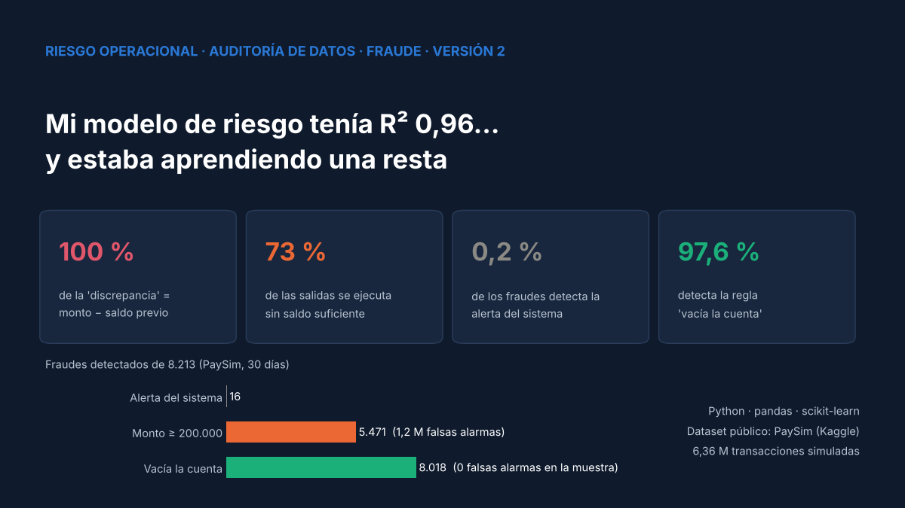
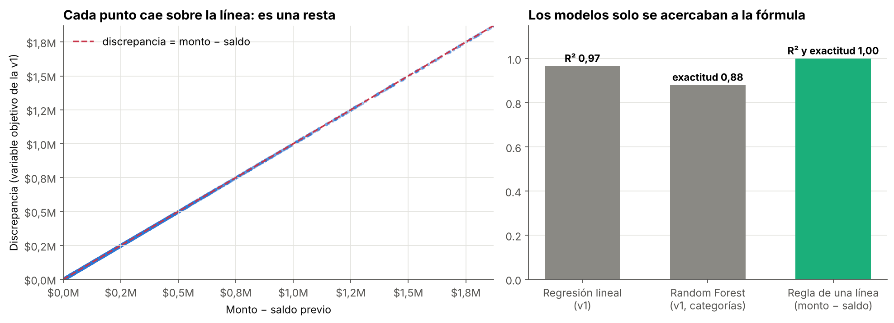
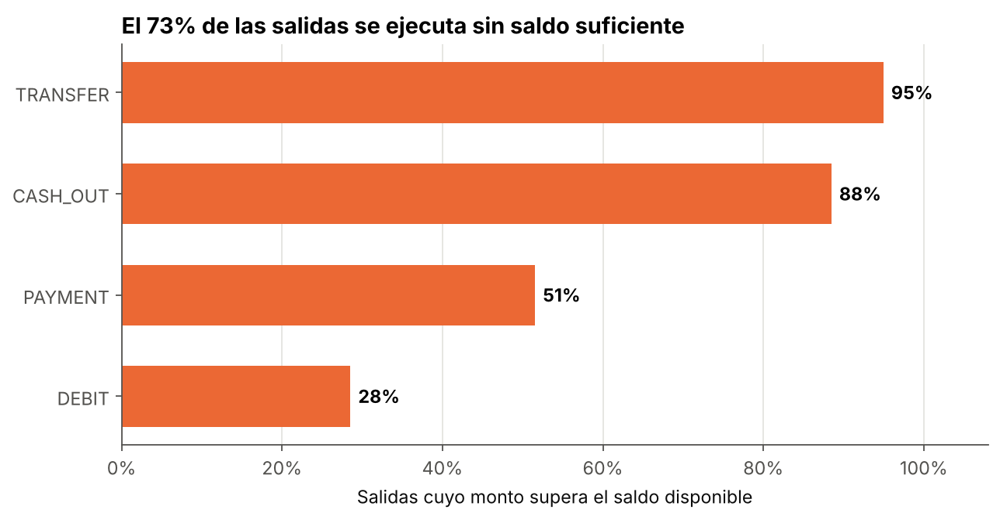
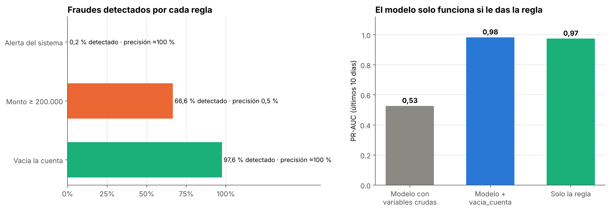
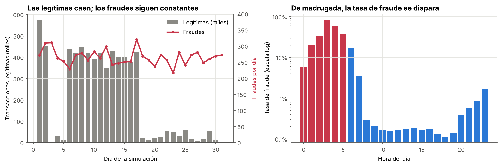

# 🔍 Riesgo operacional en PaySim: mi modelo aprendía una resta

> **Versión 2.** Revisé mi modelo de "discrepancia de conciliación" (R² 0,96) y descubrí que la variable objetivo era una **fórmula exacta** de dos de sus variables de entrada. Esta versión audita ese objetivo, explica lo que la discrepancia sí revela y se enfoca en el riesgo real del dataset: el **fraude**, donde una regla de negocio detecta el 97,6 % frente al 0,2 % de la alerta del sistema.




---

## 🔁 Qué cambió respecto de la versión 1

| | Versión 1 | Versión 2 |
|---|---|---|
| Enfoque | Predecir la "discrepancia de conciliación" | **Auditar el objetivo antes de modelarlo** |
| Discrepancia | Regresión lineal · R² 0,96 | Fórmula exacta: `máx(0, monto − saldo previo)` · R² 1,00 |
| Categorías de riesgo | Random Forest · 88 % de exactitud | Regla de una línea · 100 % |
| Qué mide la discrepancia | Riesgo de conciliación | Salidas **ejecutadas sin saldo suficiente** (artefacto del simulador) |
| Fraude | No analizado | Regla "vacía la cuenta": **97,6 %** de los fraudes (sistema: 0,2 %) |
| Validación | Split aleatorio | **Validación temporal** (últimos 10 días) |

La versión 1 (scripts, dashboard de Streamlit y modelo) se conserva en [`version_original/`](version_original/).

## ❌ Error 1: la discrepancia es una resta



Cuando una salida de dinero supera el saldo disponible, PaySim la ejecuta igual y deja el saldo en 0. Por eso la "discrepancia" que construí es exactamente lo que faltaba: `máx(0, monto − saldo previo)`, en el **100 %** de las transacciones (con una diferencia máxima de 1 centavo por redondeo).

Excluir los saldos posteriores evitaba la fuga de datos más obvia, pero el objetivo seguía siendo una **función determinística** de `amount` y `oldbalanceOrg`. La regresión no descubrió un patrón de riesgo: aproximó una resta con una recta.

## ❌ Error 2: las categorías de riesgo también

Las categorías Bajo / Medio / Alto salían de la misma resta: una regla de una línea las reproduce al **100 %**, frente al 88 % del Random Forest. Además, como "Bajo" exigía `discrepancia == 0`, un **13 %** de las transacciones quedaba en riesgo "Medio" por **1 centavo** de redondeo de punto flotante.

## ❌ Error 3: lo que la discrepancia realmente mide



El **73 %** de las salidas de dinero (y el 95 % de las transferencias) se ejecuta por un monto mayor al saldo disponible. En un banco real sería una falla de control grave; en PaySim es una **simplificación del simulador**. Conclusión: los saldos de PaySim no sirven para estudiar conciliación. El riesgo para el que fue diseñado es el fraude.

## 🚨 El riesgo real: fraude

Se usan las transacciones legítimas de la muestra (con peso 50 para estimar a escala real) y **todos** los fraudes.



| Regla | Fraudes detectados (de 8.213) | Falsas alarmas estimadas |
|---|---|---|
| Alerta del sistema (`isFlaggedFraud`) | 16 (0,2 %) | 0 |
| Monto ≥ 200.000 en transferencias o retiros | 5.471 (66,6 %) | ~1,2 millones |
| **Vacía la cuenta** (monto = saldo previo) | **8.018 (97,6 %)** | **0 en la muestra** |

Un Gradient Boosting con las variables crudas, validado en los últimos 10 días, no descubre el patrón (PR-AUC 0,53): "monto **igual** al saldo" es una relación entre dos variables, y un árbol compara cada variable por separado. Con la variable `vacia_cuenta` llega a **0,98**, prácticamente lo mismo que la regla sola (0,97). **La ingeniería de variables con criterio de negocio vale más que el algoritmo.**

## 🧪 ¿Qué tan realista es PaySim?



- Desde el día 18, las transacciones legítimas caen de ~350 mil a ~27 mil por día, mientras los fraudes siguen en ~265 por día: la prevalencia cambia artificialmente.
- El fraude se reparte parejo en las 24 horas, pero la actividad legítima casi desaparece de madrugada: entre 0 y 5 h, cerca de **1 de cada 5** transferencias o retiros es fraude (vs. 0,16 % de día).

Por eso los resultados de PaySim (muchos notebooks públicos reportan ROC-AUC ≈ 0,99) no se trasladan directamente a datos reales.

## 💡 Conclusiones

1. **Un R² de 0,96 con variables simples era una señal de alerta, no un logro.** Si el objetivo se construye con las mismas columnas que lo predicen, el modelo aprende aritmética.
2. **Antes de modelar, verificar si el objetivo es una regla.**
3. **La discrepancia es un hallazgo de control para reportar**, no algo que predecir.
4. **Una regla de negocio bien pensada supera a la alerta existente** y a un modelo sin las variables correctas.

## 🗂️ Estructura del repositorio

```
prediccion-riesgo-operacional-/
├── data/                  # Muestra del 2 % + todos los fraudes (ver data/README.md)
├── images/                # Gráficos de la versión 2
├── notebooks/
│   └── riesgo_operacional_paysim_v2.ipynb
├── reports/               # Reglas, modelos y comparación antes/después (CSV)
├── version_original/      # Scripts, dashboard y modelo de la versión 1
├── requirements.txt
├── LICENSE
└── README.md
```

## ▶️ Cómo reproducirlo

```bash
git clone https://github.com/Cristobal-111/prediccion-riesgo-operacional-.git
cd prediccion-riesgo-operacional-
pip install -r requirements.txt
jupyter notebook notebooks/riesgo_operacional_paysim_v2.ipynb
```

Los datos necesarios ya están en `data/` (10 MB); no hace falta descargar el CSV completo de 471 MB.

## ⚠️ Limitaciones

- PaySim es **sintético**: sus patrones de fraude siguen reglas del simulador.
- Las tasas a escala real se estiman con una muestra del 2 % de las transacciones legítimas.

## 📚 Fuente de datos

[PaySim — Kaggle](https://www.kaggle.com/datasets/ealaxi/paysim1) · López-Rojas, E. A., Elmir, A. y Axelsson, S. (2016). *PaySim: A financial mobile money simulator for fraud detection*. EMSS, Larnaca, Chipre.

Proyecto basado en la metodología del **Google Advanced Data Analytics Professional Certificate** (Coursera).

## 👤 Autor

**Cristóbal Rojas Troncoso** · Ingeniero Civil Industrial | Inteligencia de negocios y análisis de datos
[LinkedIn](https://www.linkedin.com/in/cristobal-rojas-troncoso/) · [GitHub](https://github.com/Cristobal-111)
